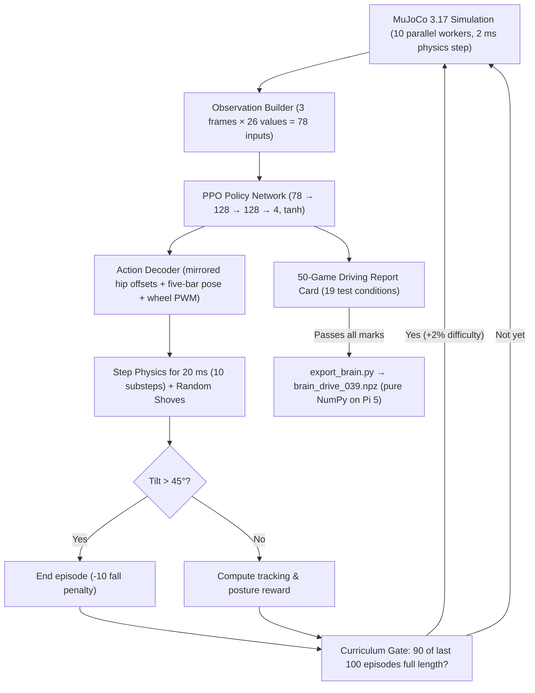

Road Runner Mini is a small wheeled bipedal robot about 1.75 kg with its battery and is built around two five-bar legs with a powered wheel at the end of each foot. Unlike a four-wheeled rover, it cannot simply sit still when its motors turn off. Left to itself, a wheeled biped falls over in a fraction of a second, so every movement, such as standing still, accelerating forward, turning on the spot, or crouching down, has to happen while balancing on a moving base like an inverted pendulum.

On paper, training a reinforcement learning (RL) policy to do this looks simple enough. You load a physics model into MuJoCo, wrap it in a Gymnasium environment, throw Proximal Policy Optimisation (PPO) at it for a few million steps, and watch the robot learn to stand and roll around.

As we quickly found out while building Road Runner Mini, getting a policy to stay upright in a clean replay is one thing; getting a policy that drives at commanded speed, resists drifting off across the room, crouches smoothly, and passes stress tests across hundreds of randomised robots is another matter altogether. Along the way, we hit policies that crept forward until they fell, policies that drove at half speed to hoard motor torque, policies that hunted back and forth around zero speed, and curriculum runs that levelled up even though the robot was still crashing on half its runs.

This article walks through how we designed and trained the locomotion policy (`drive_039`) for Road Runner Mini: how we structured the action space around the five-bar leg geometry, what we put in the 78-number observation vector, the reward bugs we hit and how we fixed them, our gated curriculum, and how we grade and export the trained neural network to run in plain NumPy at 50 Hz on a Raspberry Pi 5. Bridging the sim-to-real gap with our measured servo models, filters, and hardware tests deserves its own deep dive, so we will cover that in a follow-up post.

## How the Training Loop Fits Together

Road Runner Mini runs its onboard decisions on a Raspberry Pi 5 at **50 Hz**, that is one new decision every 20 milliseconds. Everything in the training pipeline mirrors that timing. We simulate the robot in MuJoCo 3.17 using a 2-millisecond physics step (`SIM_DT = 0.002 s`), which means 10 physics substeps run for each 20-millisecond policy decision.

We originally tested a 1-millisecond physics step, but 2 milliseconds produces the same evaluation report card while training **1.75 times faster** on CPU. Because the simulation is lightweight (simple geometric primitives handle contacts while meshes are visual-only), we run 10 parallel robot copies across CPU cores via Stable-Baselines3's `SubprocVecEnv` right on a Mac, with no GPU cluster required.



Splitting the work into two environments kept iteration clean:

1. `balance_env.py` owns the base physics, sensor simulation, servo limits, delays, domain randomisation, and fall checks.
2. `drive_env.py` inherits from `BalanceEnv` and adds speed, turn, and leg-height commands along with the tracking rewards and the evaluation report card.

## Designing the Action Space: Structure Beats Penalties

Every leg on Road Runner Mini is a planar five-bar linkage driven by two Feetech STS3215 servos sitting side by side in the body, 50 mm apart. Each hip servo swings a 60 mm upper link, and two 100 mm lower links meet at the wheel axle. At the bottom of each leg sits a Waveshare ST3215-HS servo driving a 70 mm Pololu wheel in direct PWM motor mode.

With four hip servos and two wheels, the obvious action space has **six numbers**: one target angle per hip and one PWM command per wheel. That was our first mistake.

When each hip received its own command, the policy regularly discovered lopsided postures—standing with one leg bent higher than the other on flat ground. Adding a penalty term in the reward (`-0.3 * ((legs[0] - legs[1]) / 0.01) ** 2`) helped somewhat, yet uneven stances kept creeping back whenever posture terms competed with balance recovery.

So we changed the structure instead of tuning the penalty. With `MIRROR = 1`, the neural network only outputs **four numbers**:

1. **Front hip offset** (applied identically to front-left and front-right hips)
2. **Rear hip offset** (applied identically to rear-left and rear-right hips)
3. **Left wheel PWM** (`-1` to `+1`)
4. **Right wheel PWM** (`-1` to `+1`)

Because left and right hips receive the exact same command, both legs stay the same length by construction, and the level-legs reward penalty can sit at zero. The trade-off is that the robot cannot deliberately lean one leg shorter to level itself on a sideways slope—an acceptable trade for flat-ground balancing and driving.

### Crouching Without Learning Kinematics From Scratch

Rather than forcing the RL policy to learn five-bar inverse kinematics from scratch just to hold a commanded height, we compute the nominal joint pose analytically using the law of cosines in `sim/build_model_v03.py` and build a 76-point lookup table covering heights from 65 mm to 140 mm:

```python
def leg_angles(h):
    """Given hip-to-axle vertical distance h (axle straight below hip centre),
    return (theta_front, theta_rear) hip angles for the symmetric five-bar."""
    d = math.hypot(HIP_DX, h)
    cos_a = (L1**2 + d**2 - L2**2) / (2 * L1 * d)
    a = math.acos(max(-1, min(1, cos_a)))
    phi = math.atan2(-HIP_DX, h)
    th_f = -(phi + a)
    th_r = -th_f
    return th_f, th_r
```

When a user or test asks for a new leg height (commanded between **80 mm and 135 mm** to leave a safety margin inside the 65–140 mm mechanical stops, with **120 mm** as normal stand height), we interpolate `stand_hips` for that height. The policy's hip outputs only add a **±0.35 rad** offset around `stand_hips`, rate-limited (`HIP_SLEW`) to **1.0 rad/s** so the legs still move fast enough to crouch and shift weight without feeding sharp, high-frequency vibrations into the chassis.

### Direct Wheel PWM and Speed Headroom

For the wheels, the policy's output goes straight to the ST3215-HS servo as a raw PWM duty cycle in `[-1, +1]`—the Pi adds no velocity PID loop underneath it. Notice why command speeds are capped fairly conservatively: at 11.1 V, the 70 mm wheels top out around `10.3 rad/s` no-load (~`0.36 m/s`), and in testing `0.20 m/s` was already sitting near the motor's practical limit.

A balancing robot always needs spare torque and wheel speed in reserve to catch itself when pushed or tilted forward. If a command already uses up all available wheel speed, the controller has nowhere left to accelerate when the body tips past vertical. For that reason, we cap forward speed commands at **0.15 m/s**, reverse at **0.10 m/s** (reverse at `0.15 m/s` fell in every early test), and turning at **1.5 rad/s**.

## What the Brain Sees: The 78-Number Observation

A strict rule in our training environment is that **everything inside `observe()` must come from a sensor that actually exists on the real robot**. True world position, true forward speed, and true tilt are only allowed inside `score()`, never in the observation vector.

At each 50 Hz step, `DriveEnv.observe()` packs **26 numbers** into a frame, and we stack the **3 most recent frames** (`HISTORY = 3`) into a flat vector of **78 numbers**:

| Signal | Count | Source / Scaling | Why It Is Included |
| --- | ---: | --- | --- |
| Gravity vector ("down") | 3 | Complementary filter (`DownFilter`) | Which way is down in the body frame |
| Angular velocity (`gyro`) | 3 | 6 Hz 2-pole low-pass filter (`rad/s`) | Body pitch, roll, and turn rate |
| Hip position errors | 4 | `qpos - stand_hips` (`rad`) | How far each hip deviates from current target height |
| Hip velocities | 4 | Scaled × 0.1 (`rad/s`) | Joint motion using the servo's two-tap speed behaviour |
| Wheel velocities | 2 | Scaled × 0.1 (`rad/s`) | Computed from 4096-count position deltas, not raw speed register |
| Normalised commands | 3 | `[(speed)/0.15, (turn)/1.5, (height - 0.12)/0.05]` | What the driver is asking for |
| Velocity & heading lags | 2 | `lag / 0.25`, `heading_lag / 0.50` | Leaky "behind schedule" errors for tracking |
| Hold odometer | 1 | `hold / 1.0` | Non-leaking drift distance while commanded to stand still |
| Previous action | 4 | Clipped in `[-1, 1]` | Smooths action transitions under command delay |
| **Total per frame / 3-frame stack** | **26 / 78** | **Flat `float32` vector** | Gives a plain MLP velocity trends & delay context |

Stacking three frames of history is doing a lot of quiet work here. A tiny two-layer feedforward network (`128 → 128`) has no recurrent memory of its own; seeing the last 60 milliseconds of readings lets it average out sensor noise and estimate acceleration and command lag directly.

### The Integrator Bug and the 0.9-Metre Creep

The three scalar memory terms (`lag`, `heading_lag`, and `hold`) came directly out of watching early brains fail on the floor.

Without `lag` and `heading_lag`, the policy only sees instantaneous wheel speed and gyro turn rate. On a heavier robot, a weak battery, or higher carpet friction, it settles below the target speed, just like a proportional controller without an integral term. To fix this, we accumulate how far behind schedule the robot is in distance and heading angle:

```python
if self.steps == 0:
    self.lag = self.heading_lag = self.hold = 0.0
else:
    if self.command[0] == 0.0:
        self.hold = float(np.clip(self.hold + WHEEL_R * np.mean(wheel_vel) / POLICY_HZ, -HOLD_MAX, HOLD_MAX))
    self.lag = float(np.clip(LEAK * self.lag + (self.command[0] - WHEEL_R * np.mean(wheel_vel)) / POLICY_HZ, -LAG_MAX, LAG_MAX))
    self.heading_lag = float(np.clip(LEAK * self.heading_lag + (self.command[1] - gyro[2]) / POLICY_HZ,
                                     -HEADING_LAG_MAX, HEADING_LAG_MAX))
```

Notice two load-bearing details in those seven lines:

First, **the leak (`LEAK = 0.99`)**. Early runs without decay (`drive_016`) suffered classic integrator wind-up: if the robot couldn't match a sharp command immediately, `lag` hit its `±0.25 m` cap and stayed pinned there for the entire episode. Multiplying by `0.99` each step gives a half-life of roughly `1.4 s`, so old errors fade out once a push or turn settles.

Second, **why `hold` does not leak**. That `0.99` leak solved wind-up while driving, but it created a sneaky blind spot when standing still. A slow creep of `1 cm/s` barely registers in a leaky integrator that forgets after two seconds. In real floor testing, `drive_020` crept forward smoothly by **0.9 metres** without ever triggering a large `lag` error until it tipped over. Adding `self.hold`—an odometer that only runs when `speed == 0`, resets when a new command arrives, and **never leaks**—alongside longer `4–10 s` stand-still commands in training made slow drift immediately visible to both the policy and the reward.

## Reward Shaping: What Actually Went Wrong and How We Fixed It

Getting an RL reward right rarely happens on the first try. Every weight in `DriveEnv.score()` exists because an earlier policy exploited a loophole:

```python
def score(self, action):
    g = self.true_gravity()
    tilt = np.arccos(np.clip(-g[2], -1, 1))
    forward, turn = self.body_speed()
    alive = 1.0
    go = 2.0 * np.exp(-(forward - self.command[0]) ** 2 / 0.01) - 3.0 * abs(forward - self.command[0])
    steer = 1.0 * np.exp(-(turn - self.command[1]) ** 2 / 0.03) - 0.2 * abs(turn - self.command[1])
    tall = 0.5 * np.exp(-(self.height() - self.command[2]) ** 2 / 0.0001)
    upright = -UPRIGHT_W * tilt ** 2
    wx, wy = self.d.sensordata[self.gyro:self.gyro + 2]
    wobble = -WOBBLE_PITCH_W * min(wy ** 2, WOBBLE_CLIP) - 0.05 * wx ** 2
    smooth = -SMOOTH_W * np.sum((action - self.last_action) ** 2)
    hips = -HIP_W * np.mean(np.asarray(action)[:-2] ** 2)
    hold = -HOLD_W * self.hold ** 2 - HOLD_LIN * max(abs(self.hold) - HOLD_FLAT, 0.0) if self.command[0] == 0.0 else 0.0
    return alive + go + steer + tall + upright + wobble + smooth + hips + hold, tilt
```

And here is what each term actually fixes, along with the failure mode that forced us to change it:

| Reward Term | Formula / Weight | Failure Mode It Fixed |
| --- | --- | --- |
| `alive` | `+1.0` per step (`-10.0` on fall) | Base incentive to stay above `FALL_TILT` (45°) |
| `go` & `steer` | Gaussian bell curve + linear error penalty | Gaussian alone plateaued far from target; robots drove at half speed |
| `tall` | `0.5 * exp(-(h - h_cmd)^2 / 0.0001)` | Tracks crouch/extend commands within ~1 cm |
| `upright` | `-10.0 * tilt^2` | At `2.0`, policies stood leaning **7° backward** with crooked hips |
| `hips` | `-1.0 * mean(hip_action^2)` | At `0.1`, policies picked awkward asymmetrical hip biases |
| `wobble` | `-1.0 * min(wy^2, 1.0) - 0.05 * wx^2` | Penalises 3.5 Hz pitching without punishing big shove recoveries |
| `smooth` | `-0.2 * sum(Δaction^2)` | Raised from `0.05` after `drive_021` buzzed on hardware |
| `hold` | `-hold^2 - 3.0 * max(\|hold\| - 0.02, 0)` | Linear penalty stops slow creep; 2 cm dead-zone stops deadband hunting |

Three of those bugs are worth calling out in a bit more detail:

**The half-speed driving bug.** Even when the wheel motors had plenty of torque left, early policies stubbornly drove at half the commanded speed. It turned out to be two issues at once. First, a Gaussian tracking reward drops near zero when error is large, so gradient signal weakens far from the target; adding a linear `-3.0 * abs(forward - cmd)` term pulls the robot steadily towards the command from any speed. Second, we had carried over the `12°` start leans and `0.45 N·s` shoves from the pure-balance task—values right at the motors' physical recovery limit. Facing constant survival-threatening shoves, the policy learned to hoard wheel speed rather than spend it driving. We wrote `envscan.py` to sweep start leans and shoves with frozen hips, find the biggest disturbances the plant could survive 9 times out of 10, and scaled level-1 driving disturbances down to ~80% of that limit (`6°` lean, `0.20 N·s` shove).

**Stand-still hunting around the deadband (`drive_026`).** Adding `-3.0 * abs(self.hold)` stopped the 0.9-metre creep, only for `drive_026` to start rocking ±5 cm forward and back while trying to stay still. The real ST3215-HS wheels have a **0.040 PWM deadband**—anything smaller produces zero push. Trying to drive `|hold|` all the way down to `0.000 m` forced the policy to overshoot back and forth across that deadband. Adding a 2 cm flat zone (`HOLD_FLAT = 0.02`) lets the wheels rest inside ±2 cm without hunting.

**Why `wobble` is clipped at 1.0.** A quadratic pitch-rate penalty (`-1.0 * wy^2`) is great for stamping out persistent 3.5 Hz rocking (an RMS wobble of `0.2 rad/s` costs `0.04` per step, which adds up over a 10-second run). Unclipped, though, a single hard shove causing a `4 rad/s` recovery swing would cost `16.0` in one step—making an early fall (`-10.0`) look *cheaper* than recovering! Clipping `wy^2` at `1.0` keeps recovery worth fighting for while steadily charging for continuous rocking.

Two training regimes rounded out the environment for `drive_039`: stepped command stairs (`CMD_STAIR = 1`, matching how our gamepad steps speed by `0.05 m/s` and turn by `0.25 rad/s` every 0.2 s) and **frozen-hip games (`FROZEN_SHARE = 0.15`)**, where 15% of episodes freeze the hips at 120 mm so `--freeze-hips` diagnostic runs work cleanly on hardware without surprising the policy.

## Training with PPO and a Gated Curriculum

If you drop an untrained network straight into level 100%—randomised servo delays, sensor noise, centre-of-mass shifts, crooked IMUs, 6° tilts, and random shoves—it fails completely. Every episode ends in under half a second before PPO ever learns what keeping balance feels like.

Instead, we train with a gated curriculum starting at `difficulty = 0.0` (clean nominal robot, small leans) and stepping up **2%** at a time towards `1.0`:

```python
def _on_rollout_end(self):
    if self.lengths:
        n = self.num_timesteps
        print(f"{n:>9,} decisions | {time.time() - self.t0:6.0f} s | "
              f"games {len(self.lengths):4d} | lasted {np.mean(self.lengths):5.2f} s | passed {np.mean(self.passed) * 100:3.0f} % | "
              f"score {np.mean(self.scores):7.1f} | level {self.difficulty * 100:3.0f} %", flush=True)
        # Next level only when LEVEL_UP_SHARE of the last LEVEL_GAMES games had no fall.
        self.recent = (self.recent + self.passed)[-LEVEL_GAMES:]
        full = np.mean(self.recent) if self.recent else 0.0
        if len(self.recent) >= LEVEL_GAMES and full >= LEVEL_UP_SHARE and self.difficulty < 1.0:
            self.difficulty = min(1.0, self.difficulty + 0.02)
            self.set_difficulty()
            self.recent = []
```

Earlier on, our gate checked whether the **median game length reached 8 seconds** (out of 10). That turned out to be a trap: a policy could fall in 40% of its runs and still clear 8 seconds at the median, pushing difficulty up before balance was actually solid and causing training to collapse at higher levels. Changing the rule so difficulty only increases when **90 of the last 100 games survive to the full time limit without a fall** made progression completely reliable. Saving `level.txt` next to `latest.zip` lets us hit `Ctrl+C` at any point and resume cleanly without losing curriculum progress.

On the PPO side, one hyperparameter mattered far more than expected: `log_std_init = -1.5`. Stable-Baselines3 defaults to `0.0`, which injects `±1.0` exploration noise straight into the actions. For a delicate inverted pendulum with a 0.040 wheel deadband and small balancing corrections, `±1.0` random noise completely drowns out useful control signals. Starting standard deviation around `exp(-1.5) ≈ 0.22` with two 128-neuron `tanh` hidden layers, `gamma = 0.99` (~2 seconds of lookahead at 50 Hz), `n_steps = 1024`, `batch_size = 2048`, and `20,000,000` total decisions lets PPO discover smooth balancing early and tighten its policy over the run.

## Grading a Brain: The 50-Game Report Card

Watching a robot look graceful in five interactive MuJoCo replays is dangerously misleading. With domain randomisation, a single bad corner case might only appear once every twenty episodes; if you only run six test games, one fall shifts your survival rate by 17%.

Before any checkpoint earns export to the Pi, it runs through `drive_env.py --test`, a 19-line suite running **50 games per line** (950 simulated episodes across CPU cores):

| Line Group | Conditions Tested | What It Catches |
| --- | --- | --- |
| Standing & height holds | `0.0 m/s` at `120 mm`, `80 mm` crouch, `135 mm` tall for **60 s** | Slow creep, hunting, pitch rms (`< 1°`), wheel travel (`< 0.3 rad`) |
| Driving & corners | `+0.15 m/s` forward, `-0.10 m/s` back, `1.5 rad/s` turn, height + speed + turn together | Speed under-tracking, uneven legs, tipping at combined limits |
| `[HARD PLANT]` | Softest hip flex (`10 Nm/rad`), light wheel rotor, half torso inertia | High-frequency `9–13 Hz` buzzing on compliant parts |
| `[FROZEN HIPS]` | Hips locked at `120 mm`, wheels only | Isolates wheel balance and `d(gyro)/d(wheel)` parity with hardware |
| `[STRESS]` | Full `12.6 V` battery, `40 ms` command delay, `0.02` deadband | Slow `2.5–5 Hz` rocking (`< 0.10 rad/s` mean, `< 0.20` max) |
| `[JUMP]` | Instant `0 → 0.15 m/s` command step without gamepad ramping | Worst-case step stability when commands aren't stepped |

A key rule we enforced in `drive_env.py` and `buzz_report.py` is **measuring simulation and hardware with the exact same code**. Both the report card and our offline Raspberry Pi log analyser pass their traces through the exact same `rock_band()` FFT bandpass and `count_flips()` functions, computing wheel velocity from position steps rather than mixing true simulator velocity with quantised Pi readings.

Our current default brain, `drive_039`, graduated against these marks: 50/50 survival across standing, gentle driving, and crouching lines, mean 2.5–5 Hz gyro rocking under `0.05 rad/s` on normal driving lines (and under `0.10 rad/s` on stress lines and across every standing and 0.15 m/s game), with zero `9–13 Hz` buzz.

## Exporting to the Pi 5: Zero PyTorch Required

We do not run PyTorch or Stable-Baselines3 on the Raspberry Pi 5. Once a policy passes the report card, `rl/export_brain.py` extracts the three linear weight matrices and bias vectors from `latest.zip`—just **27,140 float parameters** for a `78 → 128 → 128 → 4` network—and bundles them into `robot/brains/brain_drive_039.npz` alongside every observation scale, filter cutoff, command limit, and the five-bar height lookup table.

Inference on the Pi in `robot/brain.py` is 23 lines of pure NumPy:

```python
class Brain:
    def __init__(self, path):
        z = np.load(path)
        self.c = {k: z[k] for k in z.files}
        n = int(self.c["n_layers"])
        self.layers = [(self.c[f"w{i}"].astype(np.float64), self.c[f"b{i}"].astype(np.float64)) for i in range(n)]

    def act(self, obs):
        x = np.asarray(obs, dtype=np.float64)
        for i, (w, b) in enumerate(self.layers):
            x = w @ x + b
            if i < len(self.layers) - 1:
                x = np.tanh(x)
        return np.clip(x, -1.0, 1.0)
```

Before saving, `export_brain.py` steps the exported `Brain` alongside the original SB3 `PPO` model across three full episodes and aborts if the maximum action discrepancy exceeds `1e-4`. And because `robot/controller.py` builds observations using the filter and command constants stored inside the `.npz` file itself, changing an observation filter in training can never silently go out of sync with the code running on the robot.

## Trade-offs and What Is Still Left

None of these choices come for free:

- **Mirrored hips vs. uneven terrain:** Fixing left and right hip commands to move together solved flat-ground leg levelling instantly, but it gives up independent left/right suspension. Driving across significant side slopes or kerbs will eventually need a controlled way to unlock per-leg offsets.
- **Conservative top speed:** Capping forward speed at `0.15 m/s` (and reverse at `0.10 m/s`) keeps plenty of motor torque for balance recovery, at the cost of making Road Runner Mini a careful indoor cruiser rather than a fast rover. Large external shoves remain out of scope because the ST3215-HS wheel servos simply lack the torque-speed margin to recover from them.
- **Stand-up after falling is still parked:** Our recovery work (`getup_env.py`) is currently shelved. When the robot hits the 35° Pi safety cutoff, its legs go limp and you have to pick it back up by hand.
- **Passing simulation wasn't the finish line:** Even with a clean 50-game report card in clean sim, our earliest deployed policies buzzed at 11 Hz and rocked at 3.5 Hz on the real servos until we measured the hardware delays, deadbands, and chassis flex directly.

## Lessons Learned

1. **Structure beats reward penalties.** Spending days tuning `-0.3 * (L - R)^2` never stopped uneven stances cleanly; mirroring the front and rear hip commands eliminated the failure mode completely.
2. **Never advance a curriculum on average or median episode length.** A median of 8 seconds lets a level pass with 40% crashes. Gating progression strictly on 90 of the last 100 episodes ending *without a fall* kept every difficulty jump grounded.
3. **Reward terms must be sized against each other and clipped at falls.** An unclipped quadratic rate penalty can charge more for recovering from a shove than for falling over (`-10.0`), teaching the policy to give up early.
4. **Separate short-term command tracking from stationary hold.** A leaky velocity-lag integrator fixes steady-state tracking error without wind-up, but it forgets slow drift while standing still—requiring a separate non-leaking odometer with a deadband flat zone.
5. **Test with enough games and the exact same metrics as hardware.** Watching three replays or running six trials hides rare failure modes. Fifty games per condition using identical FFT bands and position-difference wheel speeds caught issues before they wasted bench time.
6. **Package the entire observation contract with the weights.** Exporting observation filters, scaling constants, and lookup tables inside `brain_drive_039.npz` makes `run_brain.py` self-contained and prevents silent mismatch between training runs and the Pi 5.

---

Getting `drive_039` to pass a 950-episode report card in MuJoCo was only half the battle. In the next article, we will walk through what happened the first time we ran these policies on the real hardware—hunting down a 13% error in the servo's speed register, an 11 Hz resonance in the legs, and a 3.5 Hz rock that turned out to have as much to do with physics modelling as loose knee screws.
